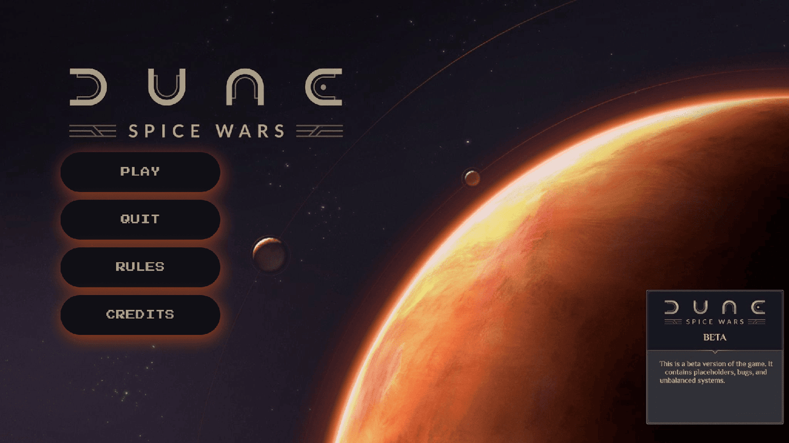

<div align="center">

# Dune: Spice Wars

**Mon tout premier jeu : défendre un vaisseau contre des météores.**

  

<sub>Projet solo · 2022</sub>

</div>

<br/>

<p align="center"></p>

## Le projet en quelques mots

Mon premier jeu en C avec la CSFML, inspiré de *Duck Hunt*. On est dans le cockpit d'un vaisseau, des météores traversent l'écran, et il faut les détruire avant d'avoir perdu toutes ses vies.

## Ce que ça fait

- Météores animés via des spritesheets
- Points de vie et écran de game over
- Menus : jouer, règles, crédits, et pause avec Échap
- Musique d'ambiance

<p align="center"></p>
<p align="center"><sub>En jeu : il faut cliquer sur les météores avant de perdre toutes ses vies</sub></p>

## Lancer le projet

```bash
make
./my_hunter
```
